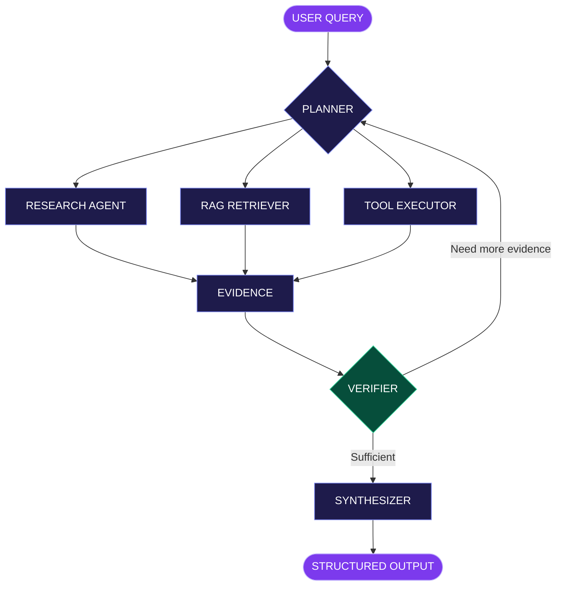

<!-- SUBHAM.AI — SINGLE-FILE GITHUB PROFILE -->

<h1 align="center">⚡ S U B H A M . A I</h1>

<p align="center">
  <strong>THE AGENTIC ENGINEERING LAB</strong>
</p>

<p align="center">
  Building AI systems that reason, retrieve, act, and verify.
</p>

<p align="center">
  
  
  
</p>

<p align="center">
  <a href="#mission-control">MISSION CONTROL</a> •
  <a href="#agent-playground">AGENT LAB</a> •
  <a href="#architecture">ARCHITECTURE</a> •
  <a href="#project-vault">PROJECTS</a> •
  <a href="#tech-stack">TECH STACK</a> •
  <a href="#live-signals">ACTIVITY</a>
</p>

---

## Mission Control

```text
╔══════════════════════════════════════════════════════╗
║                                                      ║
║                  S U B H A M . A I                   ║
║                                                      ║
║             AGENTIC ENGINEERING LAB                  ║
║                                                      ║
╠══════════════════════════════════════════════════════╣
║                                                      ║
║  ENGINEER   Subham Sekhar Patnaik                     ║
║  ROLE       Generative AI Engineer                   ║
║  SPECIALTY  AI Agents / RAG / LangGraph               ║
║  BACKEND    Python / FastAPI                          ║
║  RUNTIME    Docker / Cloud                           ║
║                                                      ║
║  CURRENT MISSION                                     ║
║  Build reliable AI systems for real problems.        ║
║                                                      ║
║  > ./explore --interactive                            ║
║                                                      ║
╚══════════════════════════════════════════════════════╝
```

### Four Core Engineering Capabilities

| 🧠 THINK | 📚 REMEMBER | ⚡ ACT | ✅ VERIFY |
|:---:|:---:|:---:|:---:|
| Planning & reasoning | RAG & retrieval | Tool execution | Evidence & evaluation |
| LangGraph | Vector databases | Function calling | Quality checks |

> **My engineering philosophy:** A useful AI system needs more than a powerful language model. It needs reliable tools, relevant knowledge, controlled execution, and measurable quality.

---

## Agent Playground

### 🎮 Choose an AI Mission

Welcome to the interactive engineering lab. Each mission reveals a different part of an AI system.

**Select a mission below to explore its workflow.**

<details>
<summary><b>🟣 MISSION 01 — Launch the Deep Research Agent</b> • Click to explore</summary>

### Mission: Deep Research

```bash
visitor@subham-ai:~$ agent run --mode=research

[BOOT]       Initializing agent
[PLANNER]    Preparing research strategy
[RESEARCH]   Gathering information
[TOOLS]      Executing tool calls
[VERIFY]     Reviewing evidence
[SYNTHESIZE] Preparing final response

[SYSTEM]     Workflow initialized
```

**Objective:** Transform complex research questions into structured, evidence-based reports.

#### Step 1 — Planning

The planner breaks a complex query into manageable research tasks.

```yaml
planner:
  input: complex_research_question
  responsibilities:
    - understand the objective
    - decompose the problem
    - create research tasks
    - select appropriate tools
  output: structured_research_plan
```

#### Step 2 — Research

Specialized research operations gather and extract relevant information.

```text
QUERY
  |
  +-- Research Task A
  |
  +-- Research Task B
  |
  +-- Information Extraction
  |
  +-- Evidence Collection
```

#### Step 3 — Verification

The verifier checks whether the evidence is sufficient before the final answer is synthesized.

```python
if evidence_is_sufficient:
    next_step = "synthesize"
else:
    next_step = "research_again"
```

#### Step 4 — Output

```json
{
  "status": "complete",
  "type": "research_report",
  "sections": [
    "summary",
    "findings",
    "supporting_evidence",
    "limitations",
    "conclusion"
  ]
}
```

**Technologies:** Python · LangGraph · OpenAI API · FastAPI

**MISSION COMPLETE — RESEARCH WORKFLOW EXPLORED**

</details>

<details>
<summary><b>🔵 MISSION 02 — Enter the RAG Knowledge Engine</b> • Click to explore</summary>

### Mission: Retrieval-Augmented Generation

```bash
visitor@subham-ai:~$ rag-engine --initialize

[DOCUMENTS]  Loading source documents
[PROCESS]    Cleaning extracted text
[CHUNKING]   Creating document chunks
[EMBEDDING]  Generating vector embeddings
[DATABASE]   Indexing in PostgreSQL
[RETRIEVAL]  Searching relevant context
[GENERATION] Creating grounded answers

[SYSTEM]     RAG pipeline initialized
```

**Objective:** Allow users to ask questions about organizational documents and receive context-aware answers.

#### Knowledge Processing

```text
         ORGANIZATIONAL DOCUMENTS
                    |
                    v
             DOCUMENT LOADING
                    |
                    v
              TEXT CHUNKING
                    |
                    v
                EMBEDDINGS
                    |
                    v
          POSTGRESQL + PGVECTOR
                    |
                    v
              VECTOR SEARCH
                    |
                    v
           RELEVANT CONTEXT
                    |
                    v
               LLM RESPONSE
```

#### Engineering Components

| Layer | Implementation |
|---|---|
| Ingestion | Document loading and preprocessing |
| Chunking | Context-preserving text splitting |
| Embeddings | OpenAI embedding models |
| Storage | PostgreSQL with pgvector |
| Retrieval | Semantic similarity search |
| Generation | Context-grounded responses |
| Quality | Evaluation and error handling |
| Deployment | Dockerized application |

**Key lesson:** Retrieval quality strongly influences answer quality.

**Technologies:** Python · FastAPI · LangChain · OpenAI · PostgreSQL · pgvector · Docker

**MISSION COMPLETE — KNOWLEDGE ENGINE EXPLORED**

</details>

<details>
<summary><b>🟢 MISSION 03 — Inspect the Agent Tool Registry</b> • Click to explore</summary>

### Mission: AI Tool Execution

```bash
visitor@subham-ai:~$ agent tools --inspect

AVAILABLE TOOL CATEGORIES

[01] Knowledge Retrieval
[02] Web Research
[03] Information Extraction
[04] Structured Output
[05] Evidence Verification

STATUS: TOOL REGISTRY READY
```

#### How Tool Calling Works

```text
USER REQUEST
     |
     v
AGENT DECISION
     |
     v
SELECT TOOL
     |
     v
VALIDATE INPUT
     |
     v
EXECUTE TOOL
     |
     v
VALIDATE RESULT
     |
     v
CONTINUE WORKFLOW
```

#### Example Typed Tool Contract

```python
from pydantic import BaseModel

class ToolResult(BaseModel):
    success: bool
    data: dict
    error: str | None = None
```

#### Reliability Checklist

- Validate tool arguments.
- Enforce permissions and execution limits.
- Apply timeouts to external operations.
- Handle tool failures gracefully.
- Return structured results.
- Keep tool responses separate from trusted instructions.

**MISSION COMPLETE — TOOL EXECUTION EXPLORED**

</details>

> These missions illustrate the architecture and logic of AI systems. They are interactive documentation, not live API executions.

---

## Architecture

### 🧬 How I Build Multi-Agent Systems



**Architecture principles:** Plan → Research / Retrieve / Act → Verify → Synthesize.

<details>
<summary><b>🔍 Why use multiple agents?</b> • Expand the architecture notes</summary>

Multi-agent architecture can separate responsibilities so that each stage has a clear purpose.

| Component | Responsibility |
|---|---|
| Planner | Decide what work is required |
| Research Agent | Gather relevant information |
| RAG Retriever | Search trusted knowledge |
| Tool Executor | Perform controlled operations |
| Verifier | Check evidence and completeness |
| Synthesizer | Produce the final structured result |

The goal is not to maximize the number of agents.

The goal is to use the simplest architecture that reliably completes the task.

</details>

---

## Project Vault

### 🚀 Featured Engineering Projects

<details>
<summary><b>📁 PROJECT 001 — Production RAG Knowledge Worker</b> • Open blueprint</summary>

### Production RAG Knowledge Worker

An organizational knowledge assistant that processes documents and provides grounded answers through Retrieval-Augmented Generation.

**Architecture**

```text
DOCUMENTS
   |
   v
INGESTION
   |
   v
PREPROCESSING
   |
   v
CHUNKING
   |
   v
EMBEDDINGS
   |
   v
POSTGRESQL + PGVECTOR
   |
   v
SEMANTIC RETRIEVAL
   |
   v
LLM GENERATION
   |
   v
GROUNDED RESPONSE
```

**Engineering Highlights**

- Document ingestion and preprocessing.
- Context-preserving chunking.
- Vector embeddings and semantic retrieval.
- LLM generation using retrieved context.
- Evaluation and error handling.
- Docker-based packaging.

**Stack:** `Python` `FastAPI` `LangChain` `OpenAI` `PostgreSQL` `pgvector` `Docker`

</details>

<details>
<summary><b>📁 PROJECT 002 — Deep Research Multi-Agent System</b> • Open blueprint</summary>

### Deep Research Multi-Agent System

A LangGraph-based system designed to break complex research questions into smaller tasks and synthesize verified findings.

**Architecture**

```text
USER QUERY
    |
    v
PLANNER AGENT
    |
    +---- RESEARCH TASK A
    |
    +---- RESEARCH TASK B
    |
    +---- EXTRACTION TASK
    |
    v
EVIDENCE COLLECTION
    |
    v
VERIFICATION
    |
    +---- RETRY IF REQUIRED
    |
    v
REPORT SYNTHESIS
    |
    v
STRUCTURED REPORT
```

**Engineering Highlights**

- Multi-agent coordination with LangGraph.
- Research task decomposition.
- Tool calling and information extraction.
- Evidence checking.
- Structured report generation.
- FastAPI backend and Docker packaging.

**Stack:** `Python` `LangGraph` `OpenAI API` `FastAPI` `Docker`

</details>

<p align="center">
  <a href="https://github.com/Subham999100?tab=repositories">
    
  </a>
</p>

---

## Tech Stack

### 🛠️ Engineering Toolkit

**Generative AI and Agent Frameworks**

<p>
  
  
  
  
  
</p>

**Backend Development**

<p>
  
</p>

**Databases and Retrieval**

<p>
  
  
  
</p>

**Cloud and DevOps**

<p>
  
</p>

---

## Research Lab

### 🌱 Currently Exploring

<details>
<summary><b>🧠 TRACK 01 — Advanced Agentic AI</b></summary>

- Advanced LangGraph workflows.
- Agent state management and checkpoints.
- Multi-agent orchestration.
- Human-in-the-loop systems.
- Reliable tool execution.

</details>

<details>
<summary><b>📚 TRACK 02 — Retrieval Engineering</b></summary>

- RAG optimization.
- Retrieval quality evaluation.
- Vector database design.
- Embedding and chunking strategies.
- LLM evaluation and faithfulness.

</details>

<details>
<summary><b>☁️ TRACK 03 — Production AI Engineering</b></summary>

- Production-grade GenAI architectures.
- API reliability and error handling.
- Observability and tracing.
- Docker-based deployment.
- AWS cloud infrastructure.

</details>

### Engineering Philosophy

```python
engineering_principles = {
    "build": "Systems that solve real problems",
    "design": "Simple architecture where possible",
    "quality": "Evidence before confidence",
    "reliability": "Failures must be handled",
    "learning": "Experiment, evaluate, improve",
}
```

---

## Live Signals

### 📊 GitHub Activity

<p align="center">
  <a href="https://github.com/Subham999100">
    
  </a>
</p>

<p align="center">
  
</p>

<p align="center">
  
</p>

<p align="center">
  <a href="https://github.com/Subham999100?tab=repositories">Repositories</a>
  •
  <a href="https://github.com/Subham999100?tab=stars">Stars</a>
  •
  <a href="https://github.com/Subham999100?tab=followers">Followers</a>
</p>

---

## Collaboration

### 🤝 Let's Build Intelligent Systems

I'm interested in collaborating on:

- AI agents and multi-agent orchestration.
- Retrieval-Augmented Generation.
- LangGraph and LangChain applications.
- LLM-powered backend systems.
- Open-source AI engineering.

<p align="center">
  <a href="https://github.com/Subham999100">
    
  </a>
</p>

---

<details>
<summary><b>🔒 RESTRICTED TERMINAL — ACCESS UNKNOWN</b> • Click if you're curious</summary>

### Secret Developer Terminal

```bash
visitor@subham-ai:~$ sudo unlock --developer-mode

[AUTH] Checking curiosity level...
[AUTH] Curiosity confirmed.
[ACCESS] GRANTED.

----------------------------------------

      SECRET ACHIEVEMENT UNLOCKED

         THE CURIOUS ENGINEER

----------------------------------------

Most people scroll.
Engineers investigate.

Most people use technology.
Builders want to understand it.

Most people stop at errors.
Engineers debug them.

----------------------------------------

FLAG{STAY_CURIOUS_KEEP_BUILDING}

----------------------------------------
```

**You found the hidden message.**

The best engineering discoveries usually start with curiosity.

</details>

---

<p align="center">
  <strong>BUILD. LEARN. IMPROVE. REPEAT.</strong>
</p>

<p align="center">
  <sub>SUBHAM.AI — Agentic Engineering Lab</sub>
</p>
