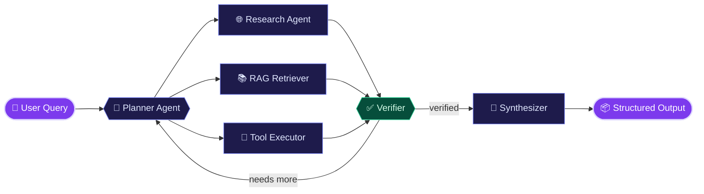

<!-- ═══════════════════════════════ HERO ═══════════════════════════════ -->
<p align="center">
  
</p>

<p align="center">
  <picture>
    <source media="(prefers-color-scheme: dark)" srcset="https://readme-typing-svg.demolab.com?font=JetBrains+Mono&weight=600&size=19&duration=2400&pause=800&color=C4B5FD&center=true&vCenter=true&width=720&lines=orchestrating+multi-agent+systems+with+LangGraph;building+production-grade+RAG+pipelines;wiring+LLMs+into+reliable+FastAPI+backends;learning+every+day.+shipping+real+systems." />
    
  </picture>
</p>

<p align="center">
  <a href="https://github.com/Subham999100?tab=repositories"></a>
  &nbsp;
  <a href="https://github.com/Subham999100?tab=followers"></a>
  &nbsp;
  
</p>

<br/>

<!-- ═══════════════════════════════ WHOAMI ═══════════════════════════════ -->
```bash
$ whoami

  name    : Subham Sekhar Patnaik
  role    : GenAI Engineer
  focus   : [ AI Agents, Agentic AI, RAG, LangGraph ]
  builds  : LLM-powered backends that actually run in production
  status  : learning every day · shipping real-world systems
```

<table align="center" width="100%">
<tr>
<td align="center" width="25%">🤖<br/><b>AI Agents</b><br/><sub>Agentic workflows & orchestration</sub></td>
<td align="center" width="25%">📚<br/><b>RAG Systems</b><br/><sub>Chunking · embeddings · retrieval</sub></td>
<td align="center" width="25%">🔧<br/><b>Tool Calling</b><br/><sub>Agents that act, not just talk</sub></td>
<td align="center" width="25%">🐳<br/><b>Production</b><br/><sub>FastAPI · Docker · AWS</sub></td>
</tr>
</table>

<br/>

<!-- ═══════════════════════════════ ARCHITECTURE ═══════════════════════════════ -->
<h2 align="center">🧬 How I Build Agents</h2>



<p align="center"><sub>Planner decomposes → specialists gather & act → verifier loops until confident → synthesizer returns structured output</sub></p>

<br/>

<!-- ═══════════════════════════════ PROJECTS ═══════════════════════════════ -->
<h2 align="center">🚀 Featured Work</h2>

<details>
<summary><b>🧠 Production RAG Knowledge Worker</b> &nbsp;·&nbsp; <code>FastAPI</code> <code>LangChain</code> <code>pgvector</code> <code>Docker</code> &nbsp;— <i>click to expand</i></summary>
<br/>

> Ask questions across organizational documents and get grounded, context-aware answers powered by **Retrieval-Augmented Generation**.

```
📄 ingest  →  ✂️ chunk  →  🧠 embed  →  🔎 retrieve  →  🤖 generate  →  📊 evaluate
```

| Layer | Implementation |
|:--|:--|
| 📄 Ingestion | Document loading & preprocessing |
| ✂️ Chunking | Intelligent, context-preserving splits |
| 🧠 Embeddings | OpenAI embeddings stored in PostgreSQL + pgvector |
| 🔎 Retrieval | Semantic vector search for relevant context |
| 🤖 Generation | LLM answers grounded in retrieved context |
| 📊 Quality | Evaluation layer & robust error handling |
| 🐳 Deployment | Fully Dockerized, production-ready |

<sub><b>Python · FastAPI · LangChain · OpenAI · PostgreSQL · pgvector · Docker</b></sub>

</details>

<details>
<summary><b>🤖 Deep Research Multi-Agent System</b> &nbsp;·&nbsp; <code>LangGraph</code> <code>OpenAI API</code> <code>FastAPI</code> <code>Docker</code> &nbsp;— <i>click to expand</i></summary>
<br/>

> Breaks complex questions into research tasks and coordinates **specialized agents** to produce verified, structured reports.

```
🧩 decompose  →  🌐 research  →  🔍 extract  →  ✅ verify  →  📝 synthesize
```

| Layer | Implementation |
|:--|:--|
| 🧩 Planning | Query decomposition into research tasks |
| 🤖 Orchestration | Multi-agent coordination with LangGraph |
| 🌐 Research | Web research & information extraction |
| ✅ Verification | Source checking before synthesis |
| 🔧 Tools | Tool calling with structured outputs |
| 📝 Output | Automated report generation |

<sub><b>Python · LangGraph · OpenAI API · FastAPI · Docker</b></sub>

</details>

<br/>

<!-- ═══════════════════════════════ STACK ═══════════════════════════════ -->
<h2 align="center">🛠️ Tech Stack</h2>

<table align="center">
<tr>
<td align="center" width="140"><b>🤖 GenAI</b></td>
<td>


</td>
</tr>
<tr>
<td align="center"><b>⚙️ Backend</b></td>
<td></td>
</tr>
<tr>
<td align="center"><b>🗄️ Data</b></td>
<td>

&nbsp;


</td>
</tr>
<tr>
<td align="center"><b>☁️ DevOps</b></td>
<td></td>
</tr>
</table>

<br/>

<!-- ═══════════════════════════════ LEARNING ═══════════════════════════════ -->
<h2 align="center">🌱 Currently Exploring</h2>

<details>
<summary><b>📖 See what I'm learning right now</b></summary>
<br/>

```yaml
agents:
  - Advanced Agentic AI architectures
  - Advanced LangGraph (state, checkpoints, human-in-the-loop)
  - Multi-agent systems & tool design

retrieval:
  - RAG architecture & optimization
  - LLM evaluation
  - Observability & tracing

production:
  - Production-grade GenAI systems
  - AI + Cloud deployment (AWS)
```

</details>

<br/>

<!-- ═══════════════════════════════ STREAK ═══════════════════════════════ -->
<h2 align="center">🔥 Consistency</h2>

<p align="center">
  <a href="https://github.com/Subham999100">
    
  </a>
</p>

<br/>

<!-- ═══════════════════════════════ COLLAB ═══════════════════════════════ -->
<h2 align="center">🤝 Let's Collaborate</h2>

<p align="center">
  
  
  
  
  
  
</p>

<p align="center"><sub>💬 Ask me about GenAI · RAG · AI Agents · LangGraph · LangChain · OpenAI API · FastAPI · Vector DBs · Python</sub></p>

<br/>

<p align="center">
  
</p>
