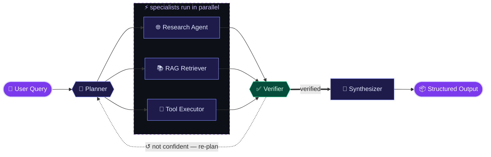
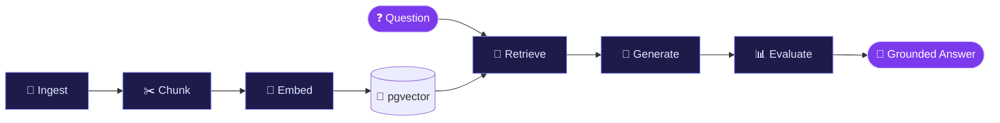
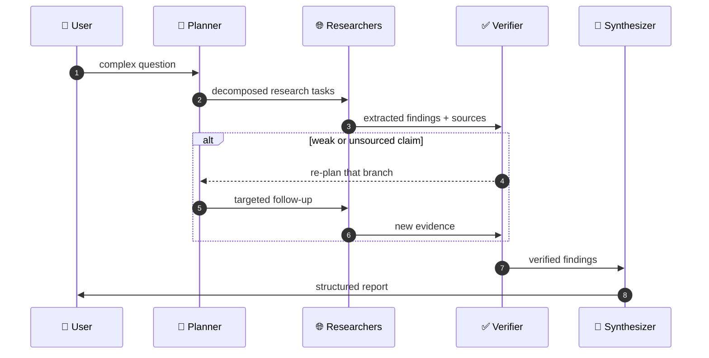

<!-- ═══════════════════════════════ HERO ═══════════════════════════════ -->
<p align="center">
  
</p>

<p align="center">
  <picture>
    <source media="(prefers-color-scheme: dark)" srcset="https://readme-typing-svg.demolab.com?font=JetBrains+Mono&weight=600&size=19&duration=2600&pause=900&color=C4B5FD&center=true&vCenter=true&width=760&lines=I+don't+build+chatbots.+I+build+systems+that+think.;planner+%E2%86%92+specialists+%E2%86%92+verifier+%E2%86%92+ship;RAG+that+grounds+every+answer+in+real+context;agents+that+act%2C+not+just+talk;from+notebook+to+production.+every+time." />
    
  </picture>
</p>

<p align="center">
  <a href="https://github.com/Subham999100?tab=repositories"></a>
  &nbsp;
  <a href="https://github.com/Subham999100?tab=followers"></a>
  &nbsp;
  
</p>

<br/>

<!-- ═══════════════════════════════ SOURCE CODE OF ME ═══════════════════════════════ -->
<h2 align="center">⚙️ My Source Code</h2>
<p align="center"><sub>if I were a LangGraph, this is how I'd compile</sub></p>

```python
from langgraph.graph import StateGraph, START, END
from subham import think, retrieve, act, verify, ship, Engineer

me = StateGraph(Engineer)

me.add_node("think",    think)     # break the problem into solvable pieces
me.add_node("retrieve", retrieve)  # ground every answer in real context
me.add_node("act",      act)       # tools, APIs, code — agents that do things
me.add_node("verify",   verify)    # trust, but check
me.add_node("ship",     ship)      # FastAPI · Docker · AWS

me.add_edge(START, "think")
me.add_edge("think", "retrieve")
me.add_edge("retrieve", "act")
me.add_edge("act", "verify")
me.add_conditional_edges("verify", lambda s: "ship" if s.confident else "think")
me.add_edge("ship", END)

subham = me.compile(checkpointer=curiosity)   # state persists. learning never resets.
subham.invoke({"problem": "yours"})           # → production-grade AI
```

<table align="center" width="100%">
<tr>
<td align="center" width="25%">🤖<br/><b>AI Agents</b><br/><sub>Planners, specialists & verifiers that cooperate</sub></td>
<td align="center" width="25%">📚<br/><b>RAG Systems</b><br/><sub>Chunk · embed · retrieve · ground · evaluate</sub></td>
<td align="center" width="25%">🔧<br/><b>Tool Calling</b><br/><sub>Structured outputs that drive real actions</sub></td>
<td align="center" width="25%">🐳<br/><b>Production</b><br/><sub>FastAPI · Docker · AWS — not just notebooks</sub></td>
</tr>
</table>

<br/>

<!-- ═══════════════════════════════ ARCHITECTURE ═══════════════════════════════ -->
<h2 align="center">🧬 Anatomy of an Agent I Build</h2>



<details>
<summary><b>▶ Watch a single run, step by step</b> &nbsp;<sub>(illustrative trace)</sub></summary>
<br/>

```diff
  $ agent.invoke("Compare vector DB options for a 10M-doc RAG system")

+ [planner]     decomposed query → 3 sub-tasks
+ [research]    gathering benchmarks & docs ............. done
+ [rag]         retrieved top-k chunks from knowledge base  done
+ [tools]       structured comparison table generated ...... done
! [verifier]    claim about latency has no source → re-plan
+ [research]    fetched supporting source ................ done
+ [verifier]    all claims grounded ✓
+ [synthesizer] structured report ready

  ✔ status: verified · output: report.json
```

</details>

<br/>

<!-- ═══════════════════════════════ PROJECTS ═══════════════════════════════ -->
<h2 align="center">🚀 Featured Builds</h2>

<details open>
<summary><b>🧠 Production RAG Knowledge Worker</b> &nbsp;·&nbsp; <code>FastAPI</code> <code>LangChain</code> <code>pgvector</code> <code>Docker</code></summary>
<br/>

> **The problem:** organizations drown in documents nobody can search. <br/>
> **The build:** ask a question in plain language, get an answer **grounded in your own documents** — not hallucinated.



| Layer | What it does |
|:--|:--|
| 📄 **Ingestion** | Loads and preprocesses organizational documents |
| ✂️ **Chunking** | Context-preserving splits so meaning survives retrieval |
| 🧠 **Embeddings** | OpenAI embeddings stored in PostgreSQL + pgvector |
| 🔎 **Retrieval** | Semantic vector search surfaces the most relevant context |
| 🤖 **Generation** | LLM answers constrained to retrieved context |
| 📊 **Quality** | Evaluation layer + robust error handling |
| 🐳 **Deployment** | Fully Dockerized, production-ready |

<sub><b>Python · FastAPI · LangChain · OpenAI · PostgreSQL · pgvector · Docker</b></sub>

</details>

<details open>
<summary><b>🤖 Deep Research Multi-Agent System</b> &nbsp;·&nbsp; <code>LangGraph</code> <code>OpenAI API</code> <code>FastAPI</code> <code>Docker</code></summary>
<br/>

> **The problem:** hard questions need more than one search and one answer. <br/>
> **The build:** a team of **specialized agents** that plans, researches, fact-checks itself, and writes a structured report.



| Layer | What it does |
|:--|:--|
| 🧩 **Planning** | Decomposes the question into focused research tasks |
| 🤖 **Orchestration** | Multi-agent coordination with LangGraph state |
| 🌐 **Research** | Web research and information extraction |
| ✅ **Verification** | Checks sources before anything reaches the report |
| 🔧 **Tools** | Tool calling with structured outputs |
| 📝 **Output** | Automated, structured report generation |

<sub><b>Python · LangGraph · OpenAI API · FastAPI · Docker</b></sub>

</details>

<br/>

<!-- ═══════════════════════════════ STACK ═══════════════════════════════ -->
<h2 align="center">🛠️ The Arsenal</h2>

<table align="center">
<tr>
<td align="center" width="140"><b>🤖 GenAI</b></td>
<td>


</td>
</tr>
<tr>
<td align="center"><b>⚙️ Backend</b></td>
<td></td>
</tr>
<tr>
<td align="center"><b>🗄️ Data</b></td>
<td>

&nbsp;


</td>
</tr>
<tr>
<td align="center"><b>☁️ DevOps</b></td>
<td></td>
</tr>
</table>

<br/>

<!-- ═══════════════════════════════ ACTIVITY ═══════════════════════════════ -->
<h2 align="center">🔥 Proof of Work</h2>

<p align="center">
  <a href="https://github.com/Subham999100">
    
  </a>
</p>

<p align="center">
  
</p>

<p align="center">
  <picture>
    <source media="(prefers-color-scheme: dark)" srcset="https://raw.githubusercontent.com/Subham999100/Subham999100/output/github-snake-dark.svg" />
    
  </picture>
</p>

<br/>

<!-- ═══════════════════════════════ LEARNING ═══════════════════════════════ -->
<h2 align="center">🌱 Currently Training On</h2>

<details>
<summary><b>📖 See what's in my context window right now</b></summary>
<br/>

```yaml
epoch: current
loss: decreasing 📉

agents:
  - Advanced agentic AI architectures
  - Advanced LangGraph (state, checkpoints, human-in-the-loop)
  - Multi-agent systems & tool design

retrieval:
  - RAG architecture & optimization
  - LLM evaluation
  - Observability & tracing

production:
  - Production-grade GenAI systems
  - AI + cloud deployment (AWS)
```

</details>

<br/>

<!-- ═══════════════════════════════ COLLAB ═══════════════════════════════ -->
<h2 align="center">🤝 Let's Build Something That Thinks</h2>

<p align="center">
  
  
  
  
  
  
</p>

```bash
$ ask subham --about "GenAI · RAG · AI Agents · LangGraph · LangChain · OpenAI API · FastAPI · Vector DBs · Python"
> response: always happy to talk. open an issue, star a repo, or just say hi 👋
```

<p align="center">
  
</p>
