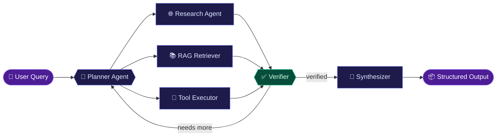

<!-- ═══════════════════════════════ BANNER ═══════════════════════════════ -->
<p align="center">
  
</p>

<p align="center">
  
</p>

<p align="center">
  <a href="https://github.com/Subham999100?tab=repositories"></a>
  
  
</p>

<br/>

<!-- ═══════════════════════════════ INTRO ═══════════════════════════════ -->
<h3 align="center">⚡ I build LLM-powered systems, from retrieval pipelines to autonomous multi-agent workflows.</h3>

<p align="center">
  Computer Science graduate turning GenAI concepts into <b>reliable backend services</b>.<br/>
  My focus: <b>Agentic AI</b>, <b>LangGraph</b>, <b>RAG</b>, <b>tool calling</b>, and <b>production deployment</b>.
</p>

<br/>

<table align="center">
<tr>
<td align="center" width="25%">🤖<br/><b>AI Agents</b><br/><sub>Agentic workflows & orchestration</sub></td>
<td align="center" width="25%">📚<br/><b>RAG Systems</b><br/><sub>Chunking, embeddings, retrieval</sub></td>
<td align="center" width="25%">🔧<br/><b>Tool Calling</b><br/><sub>Agents that act, not just talk</sub></td>
<td align="center" width="25%">🐳<br/><b>Production</b><br/><sub>FastAPI, Docker, AWS</sub></td>
</tr>
</table>

<br/>

<!-- ═══════════════════════════════ HOW I BUILD ═══════════════════════════════ -->
## 🧬 How I Build Agents



<br/>

<!-- ═══════════════════════════════ PROJECTS ═══════════════════════════════ -->
## 🚀 Featured Work

<table>
<tr>
<td width="50%" valign="top">

<h3>🧠 Production RAG Knowledge Worker</h3>


<p>Ask questions across organizational documents and get grounded, context-aware answers powered by <b>Retrieval-Augmented Generation</b>.</p>

<b>Pipeline</b><br/>
<code>ingest</code> → <code>chunk</code> → <code>embed</code> → <code>retrieve</code> → <code>generate</code> → <code>evaluate</code>

<br/><br/>

<b>Highlights</b><br/>
✦ Intelligent document chunking<br/>
✦ Vector search with PostgreSQL + pgvector<br/>
✦ LLM response generation with context<br/>
✦ Evaluation & robust error handling<br/>
✦ Fully Dockerized deployment

<br/>

<sub><b>Python · FastAPI · LangChain · OpenAI · PostgreSQL · pgvector · Docker</b></sub>

</td>
<td width="50%" valign="top">

<h3>🤖 Deep Research Multi-Agent System</h3>


<p>Breaks complex questions into research tasks and coordinates <b>specialized agents</b> to produce verified, structured reports.</p>

<b>Pipeline</b><br/>
<code>decompose</code> → <code>research</code> → <code>extract</code> → <code>verify</code> → <code>synthesize</code>

<br/><br/>

<b>Highlights</b><br/>
✦ Query decomposition & task planning<br/>
✦ Multi-agent orchestration with LangGraph<br/>
✦ Web research with source verification<br/>
✦ Tool calling & structured outputs<br/>
✦ Automated report synthesis

<br/>

<sub><b>Python · LangGraph · OpenAI API · FastAPI · Docker</b></sub>

</td>
</tr>
</table>

<br/>

<!-- ═══════════════════════════════ STACK ═══════════════════════════════ -->
## 🛠️ Tech Stack

<table align="center">
<tr>
<td align="center" width="140"><b>🤖 GenAI</b></td>
<td>


</td>
</tr>
<tr>
<td align="center"><b>⚙️ Backend</b></td>
<td></td>
</tr>
<tr>
<td align="center"><b>🗄️ Data</b></td>
<td>

&nbsp;


</td>
</tr>
<tr>
<td align="center"><b>☁️ DevOps</b></td>
<td></td>
</tr>
</table>

<br/>

<!-- ═══════════════════════════════ LEARNING ═══════════════════════════════ -->
## 🌱 Currently Exploring

```yaml
agents:       [Advanced Agentic AI architectures, Advanced LangGraph, Multi-agent systems]
retrieval:    [RAG architecture & optimization, LLM evaluation, Observability]
production:   [Production-grade GenAI systems, AI + Cloud deployment]
```

<br/>

<!-- ═══════════════════════════════ COLLAB ═══════════════════════════════ -->
## 🤝 Let's Collaborate

<p align="center">
  
  
  
  
  
  
</p>

<p align="center"><sub>💬 Ask me about GenAI · RAG · AI Agents · LangGraph · LangChain · OpenAI API · FastAPI · Vector DBs · Python</sub></p>

<br/>

<!-- ═══════════════════════════════ STREAK ═══════════════════════════════ -->
## 🔥 Consistency

<p align="center">
  
</p>

<br/>

<!-- ═══════════════════════════════ FOOTER ═══════════════════════════════ -->
<p align="center">
  <b>🚀 Building with AI. Learning every day. Shipping real-world systems.</b>
</p>

<p align="center">
  
</p>
