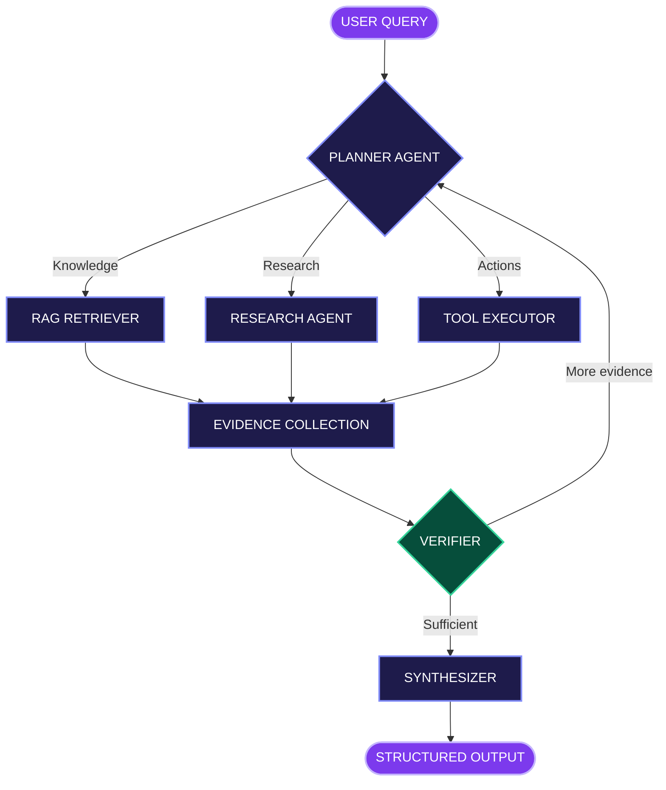

<!--
╔══════════════════════════════════════════════╗
║           S U B H A M . A I                  ║
║          THE AGENTIC ENGINEERING LAB          ║
║           GitHub Profile · V2.0               ║
╚══════════════════════════════════════════════╝
-->

<div align="center">


<br/>

<picture>
  <source media="(prefers-color-scheme: dark)" srcset="https://readme-typing-svg.demolab.com?font=JetBrains+Mono&amp;weight=600&amp;size=20&amp;duration=2200&amp;pause=900&amp;color=C4B5FD&amp;center=true&amp;vCenter=true&amp;width=850&amp;lines=Initializing+SUBHAM.AI+...;I+build+AI+agents+that+think+and+act.;RAG+%7C+LangGraph+%7C+Multi-Agent+Systems;Turning+LLM+experiments+into+real+systems.;Welcome+to+my+AI+engineering+lab." />
  
</picture>

<br/>


<br/><br/>

<a href="https://github.com/Subham999100?tab=repositories">
  
</a>
<a href="https://github.com/Subham999100?tab=followers">
  
</a>

<br/><br/>

**SYSTEM NAVIGATION**

<a href="#mission-control">MISSION CONTROL</a> ·
<a href="#agent-playground">AGENT LAB</a> ·
<a href="#architecture">ARCHITECTURE</a> ·
<a href="#featured-builds">PROJECTS</a> ·
<a href="#tech-stack">TECH STACK</a> ·
<a href="#live-signals">LIVE SIGNALS</a>

</div>

---

## Mission Control

> **Welcome, visitor.** You've entered the engineering workspace of a developer exploring how to make AI systems reason, retrieve knowledge, execute tools, and produce useful results.

```text
┌──────────────────────────────────────────────┐
│  SUBHAM.AI                         v2.0       │
├──────────────────────────────────────────────┤
│                                              │
│  USER       Subham Sekhar Patnaik            │
│  ROLE       GenAI Engineer                   │
│  ENGINE     Python / FastAPI                 │
│  BRAIN      LLMs / LangGraph                 │
│  MEMORY     RAG / Vector Databases           │
│  RUNTIME    Docker / AWS                     │
│                                              │
│  CURRENT OBJECTIVE                           │
│  Build reliable, useful agentic AI systems.  │
│                                              │
│  $ ./explore --interactive                   │
│                                              │
└──────────────────────────────────────────────┘
```

<table>
<tr>
<td align="center" width="25%">
<h3>🧠</h3>
<b>REASON</b>
<br/>
<sub>Planning &amp; decision flows</sub>
</td>
<td align="center" width="25%">
<h3>📚</h3>
<b>RETRIEVE</b>
<br/>
<sub>RAG &amp; vector search</sub>
</td>
<td align="center" width="25%">
<h3>⚡</h3>
<b>ACT</b>
<br/>
<sub>Tools &amp; orchestration</sub>
</td>
<td align="center" width="25%">
<h3>🛡️</h3>
<b>VERIFY</b>
<br/>
<sub>Evidence &amp; evaluation</sub>
</td>
</tr>
</table>

---

## Agent Playground

<div align="center">

### 🧪 Choose Your AI Mission

**This is an interactive walkthrough of the systems I build.**

`SELECT A MISSION` → `INSPECT THE WORKFLOW` → `REVEAL THE RESULT`

</div>

<details>
<summary><b>🟣 MISSION 01 — Launch the Deep Research Agent</b> · Click to enter</summary>

<br/>

```bash
visitor@subham-ai:~$ agent run --mode=deep-research

[BOOT]      Loading agent configuration
[PLANNER]   Preparing research strategy
[TOOLS]     Registering research tools
[MEMORY]    Initializing agent state
[READY]     Research workflow initialized
```

**Scenario:** A user submits a complex question that requires research, source comparison, and a structured answer.

<details>
<summary>🧩 STEP 01 — Open the Planner Agent</summary>

**Planner Agent**

The query is decomposed into research tasks.

```yaml
planner:
  input: "Complex research question"
  operations:
    - identify research objectives
    - decompose into smaller tasks
    - select tools and knowledge sources
    - define verification requirements
  output: research_plan
```

The planner decides **what information is needed and where to search**.

</details>

<details>
<summary>🌐 STEP 02 — Open the Research Agent</summary>

**Research Agent**

Independent research tasks gather relevant information.

```text
RESEARCH WORKFLOW

Task 01  → Gather relevant sources
Task 02  → Extract useful information
Task 03  → Compare retrieved evidence
Task 04  → Return structured findings
```

The agent collects evidence instead of generating an unsupported answer.

</details>

<details>
<summary>✅ STEP 03 — Open the Verification Layer</summary>

**Verifier Agent**

Before producing the response, the workflow checks:

- Whether claims have supporting evidence.
- Whether the retrieved information answers the query.
- Whether sources disagree.
- Whether additional research is required.

```python
if evidence_is_sufficient:
    next_node = "synthesizer"
else:
    next_node = "planner"
```

</details>

<details>
<summary>📦 STEP 04 — Reveal the Final Output</summary>

```json
{
  "status": "complete",
  "output_type": "research_report",
  "sections": [
    "executive_summary",
    "key_findings",
    "supporting_sources",
    "limitations",
    "conclusion"
  ],
  "verification": "evidence_reviewed"
}
```

**Mission complete.**

A structured answer is produced from the gathered evidence.

</details>

<br/>

**Technology:** `LangGraph` · `OpenAI API` · `Python` · `FastAPI`

</details>

<details>
<summary><b>🔵 MISSION 02 — Enter the RAG Knowledge Engine</b> · Click to enter</summary>

<br/>

```bash
visitor@subham-ai:~$ rag query --grounded

[LOAD]      Reading knowledge sources
[CHUNK]     Preparing document segments
[EMBED]     Generating vector representations
[SEARCH]    Retrieving relevant context
[GENERATE]  Creating grounded response
```

**Scenario:** An assistant must answer questions using information from an organization's documents.

### Inside the Retrieval Pipeline

```text
              KNOWLEDGE BASE
                    |
             DOCUMENT INGEST
                    |
             TEXT PROCESSING
                    |
               CHUNKING
                    |
               EMBEDDINGS
                    |
             VECTOR DATABASE
                    |
                RETRIEVAL
                    |
             CONTEXT + QUERY
                    |
                   LLM
                    |
             GROUNDED ANSWER
```

<details>
<summary>🔎 Inspect the Retrieval Layer</summary>

The retrieval system uses:

- Context-preserving text chunks.
- OpenAI embeddings.
- PostgreSQL with pgvector.
- Semantic similarity search.
- Retrieved context supplied to the generation step.

The goal is to make answers traceable to relevant source material.

</details>

<details>
<summary>🛡️ Inspect the Quality Layer</summary>

A reliable RAG application needs more than embeddings.

Important checks include:

- Retrieval relevance.
- Context quality.
- Faithfulness to source material.
- Missing information handling.
- Error handling and evaluation.

</details>

**Mission objective:** Answer with relevant context rather than unsupported confidence.

</details>

<details>
<summary><b>🟢 MISSION 03 — Unlock the Tool Registry</b> · Click to enter</summary>

<br/>

```bash
visitor@subham-ai:~$ agent tools --list

AVAILABLE TOOL CATEGORIES

[01] Retrieval
[02] Research
[03] Information Extraction
[04] Structured Output
[05] Verification
```

### Why tool calling matters

A useful AI agent should do more than generate text.

```text
USER INTENT
    |
    v
MODEL SELECTS A TOOL
    |
    v
TOOL EXECUTES
    |
    v
RESULT VALIDATION
    |
    v
MODEL CONTINUES WITH EVIDENCE
```

<details>
<summary>⚙️ Inspect the Tool Execution Contract</summary>

```python
from pydantic import BaseModel

class ToolResult(BaseModel):
    success: bool
    data: dict
    error: str | None = None
```

This is an illustrative typed contract.

Tool outputs should be validated before they influence later agent decisions.

</details>

<details>
<summary>🔐 Inspect the Safety Rules</summary>

**Reliable agent principles:**

- Validate tool arguments.
- Apply timeouts and execution limits.
- Handle external failures.
- Restrict access to authorized tools.
- Avoid executing untrusted instructions.
- Return structured results.

</details>

**Mission complete:** The agent can interact with its environment through controlled tools.

</details>

<p align="center"><sub>Note: The missions above are interactive demonstrations of architecture concepts, not live API executions.</sub></p>

---

## Architecture

<div align="center">

### 🧬 The Agent Brain

*How I approach multi-agent workflows*

</div>



<p align="center">
<sub>PLAN → RETRIEVE / RESEARCH / ACT → VERIFY → SYNTHESIZE</sub>
</p>

<details>
<summary>🔍 Expand: What makes this different from a basic chatbot?</summary>

| Basic chatbot | Agentic workflow |
|:---|:---|
| Responds to prompts | Plans tasks and coordinates steps |
| Primarily generates text | Can invoke external tools |
| Depends on prompt context | Can retrieve relevant knowledge |
| Often follows a single response path | Supports conditional paths and loops |
| May answer without sufficient evidence | Can incorporate explicit verification |

The objective isn't to add more agents for complexity. It's to design systems where specialized steps provide measurable value.

</details>

---

## Featured Builds

<div align="center">

### 🚀 Engineering Projects

*Real-world GenAI architectures, beyond basic prompt wrappers.*

</div>

<details>
<summary><b>PROJECT 01 / Production RAG Knowledge Worker</b> · Open technical blueprint</summary>

<br/>

**An organizational knowledge assistant using Retrieval-Augmented Generation.**

The system processes document content, indexes embeddings, retrieves relevant information, and produces context-aware responses.

```text
PROJECT BLUEPRINT 001
──────────────────────────────────────────

[ DOCUMENTS ]
      |
      v
[ INGESTION + CLEANING ]
      |
      v
[ CHUNKING ]
      |
      v
[ OPENAI EMBEDDINGS ]
      |
      v
[ POSTGRESQL + PGVECTOR ]
      |
      v
[ SEMANTIC RETRIEVAL ]
      |
      v
[ LLM GENERATION ]
      |
      v
[ GROUNDED RESPONSE ]

──────────────────────────────────────────
```

### System Components

| Component | Engineering Focus |
|:--|:--|
| Ingestion | Document loading and preprocessing |
| Chunking | Context-preserving text segmentation |
| Embeddings | OpenAI embedding generation |
| Vector storage | PostgreSQL and pgvector |
| Retrieval | Semantic similarity search |
| Generation | Context-grounded LLM answers |
| Quality | Evaluation and error handling |
| Packaging | Dockerized backend |

### Technology

`Python` `FastAPI` `LangChain` `OpenAI` `PostgreSQL` `pgvector` `Docker`

<details>
<summary>🧠 Engineering Insight — Why retrieval quality matters</summary>

Even a capable LLM can produce weak answers when the retrieved context is poor.

Good RAG engineering requires attention to document quality, chunk boundaries, embedding choices, retrieval strategy, and evaluation.

**Better context is often more valuable than a longer prompt.**

</details>

</details>

<details>
<summary><b>PROJECT 02 / Deep Research Multi-Agent System</b> · Open technical blueprint</summary>

<br/>

**A research workflow built around specialized agents coordinated with LangGraph.**

Complex questions are broken down into smaller research tasks. Findings are gathered, verified, and synthesized into structured reports.

```text
PROJECT BLUEPRINT 002
──────────────────────────────────────────

[ USER QUESTION ]
       |
       v
[ PLANNER AGENT ]
       |
       +----> RESEARCH TASK A
       |
       +----> RESEARCH TASK B
       |
       +----> EXTRACTION TASK
       |
       v
[ EVIDENCE AGGREGATION ]
       |
       v
[ VERIFICATION ]
       |
       +----> RETRY IF NEEDED
       |
       v
[ REPORT SYNTHESIS ]
       |
       v
[ STRUCTURED REPORT ]

──────────────────────────────────────────
```

### System Components

| Component | Engineering Focus |
|:--|:--|
| Planning | Query decomposition |
| Orchestration | LangGraph-based coordination |
| Research | Information gathering |
| Extraction | Structured facts from sources |
| Verification | Evidence checking |
| Tooling | Function and tool calling |
| Output | Structured report generation |
| Backend | FastAPI and Docker |

### Technology

`Python` `LangGraph` `OpenAI API` `FastAPI` `Docker`

<details>
<summary>🧠 Engineering Insight — Why verification loops matter</summary>

A multi-agent system shouldn't assume that every intermediate result is complete or correct.

Verification creates an opportunity to identify missing evidence, conflicting findings, and unanswered parts of a question.

The important engineering challenge is deciding **when to retry and when to stop**.

</details>

</details>

<p align="center">
<a href="https://github.com/Subham999100?tab=repositories">

</a>
</p>

---

## Tech Stack

<div align="center">

### ⚙️ My Engineering Toolkit

</div>

<table>
<tr>
<td><b>🧠 AI / LLMs</b></td>
<td>


</td>
</tr>
<tr>
<td><b>⚙️ Backend</b></td>
<td>

</td>
</tr>
<tr>
<td><b>🗄️ Data</b></td>
<td>


</td>
</tr>
<tr>
<td><b>☁️ Cloud &amp; DevOps</b></td>
<td>

</td>
</tr>
</table>

---

## Research Lab

<div align="center">

### 🌱 Currently Exploring

*An engineering mindset is never finished.*

</div>

<details>
<summary><b>🧠 RESEARCH TRACK 01 — Advanced Agentic AI</b></summary>

- Advanced LangGraph architectures
- Agent state and checkpointing
- Multi-agent coordination
- Human-in-the-loop workflows
- Tool design and execution reliability

</details>

<details>
<summary><b>📚 RESEARCH TRACK 02 — Retrieval &amp; Memory</b></summary>

- Advanced RAG architectures
- Retrieval optimization
- Vector search techniques
- Context management
- LLM evaluation and faithfulness

</details>

<details>
<summary><b>🚀 RESEARCH TRACK 03 — Production Engineering</b></summary>

- Production-grade GenAI system design
- Observability and tracing
- Reliable backend APIs
- Docker-based deployment
- AWS cloud infrastructure

</details>

### Engineering Principles

```python
engineering_principles = {
    "build": "Working systems over flashy demos",
    "quality": "Evidence before confidence",
    "design": "Simple architecture where possible",
    "reliability": "Handle failure explicitly",
    "learning": "Experiment, measure, improve",
}
```

---

## Live Signals

<div align="center">

### 📡 GitHub Telemetry

*Activity from the engineering workspace.*


<br/><br/>


<br/>


</div>

---

## Collaboration

<div align="center">

### 🤝 Build Something Intelligent Together

Interested in collaborating on:


<br/>


<br/><br/>

**Let's build AI systems that do useful work.**

<a href="https://github.com/Subham999100">

</a>

</div>

---

<details>
<summary>🔒 <b>RESTRICTED FILE — ACCESS UNKNOWN</b> · Curious? Click here.</summary>

<br/>

```bash
visitor@subham-ai:~$ cat /secrets/mission.txt

ACCESS GRANTED

You found the hidden developer message.

Most people scroll.
Engineers investigate.

Most people consume technology.
Builders ask how it works.

Most people stop when something fails.
Curious minds inspect the failure.

-----------------------------------------

SECRET ACHIEVEMENT UNLOCKED

       THE CURIOUS ENGINEER

-----------------------------------------

FLAG{STAY_CURIOUS_KEEP_BUILDING}
```

**Thanks for exploring beyond the surface.**

The best discoveries often begin with curiosity.

</details>

<br/>

<div align="center">

```text
> Code is the implementation.
> Curiosity is the engine.
> Learning is the process.
> Building is the outcome.
```


<sub>SUBHAM.AI · Designed around curiosity and engineering</sub>

</div>
