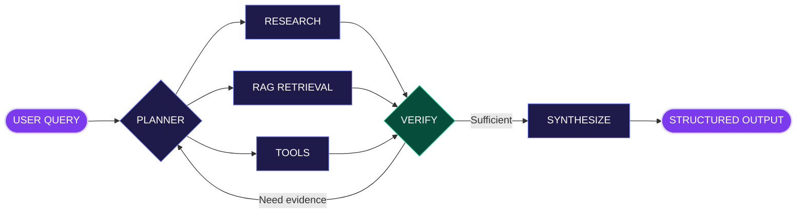

<!-- SUBHAM.AI — a GitHub-native interactive profile. No scripts, no fake dashboards. -->

AI AGENTS · LANGGRAPH · RAG · FASTAPI · PRODUCTION ENGINEERING

An interactive look at how I think, build, and explore AI systems.

🖥 Mission Control
subham@agent-lab:~$ whoami

NAME      Subham Sekhar Patnaik
ROLE      GenAI Engineer
FOCUS     AI Agents · Multi-Agent Systems · RAG · LangGraph
BUILDING  LLM-powered backends and evidence-grounded workflows
MISSION   Turn promising AI prototypes into useful, reliable systems

subham@agent-lab:~$ help
  [1] Enter the Agent Lab
  [2] Inspect the Architecture
  [3] Open the Project Vault
  [4] Discover a Secret
<table>
<tr>
<td align="center" width="25%"><b>🧠 THINK</b> Planning &amp; reasoning</td>
<td align="center" width="25%"><b>📚 REMEMBER</b> RAG &amp; retrieval</td>
<td align="center" width="25%"><b>🔧 ACT</b> Tool execution</td>
<td align="center" width="25%"><b>✅ VERIFY</b> Evidence &amp; evaluation</td>
</tr>
</table>🕹 Agent Lab
Pick a mission to explore. The panels are interactive architecture walkthroughs—not live API executions.

<b>🟣 MISSION 01 — Start the Research Agent</b> &nbsp; ▸ <i>Click to launch</i>

$ agent run --mission deep-research
[✓] Query received
[✓] Planner initialized
[✓] Research, retrieval and tool paths prepared
[→] Entering evidence-gathering workflow...

🧩 <b>STEP 01 — Planner: decide what to investigate</b>
The planner breaks a complex question into research tasks, chooses appropriate sources and defines a stopping condition.
input: complex_research_question
plan:
  - decompose_problem
  - identify_required_evidence
  - assign_research_tasks
  - define_verification_checks

🌐 <b>STEP 02 — Specialists: retrieve, research, use tools</b>
Specialized paths collect relevant documents, extract useful details and invoke controlled tools as needed. Each returns structured findings for review.

🛡️ <b>STEP 03 — Verifier: accept or investigate further</b>
if evidence_is_sufficient and claims_are_supported:
    next_step = "synthesize"
else:
    next_step = "research_again"  # with a retry limit
The verifier should identify gaps—not simply declare every answer correct.

📦 <b>STEP 04 — Reveal the structured output</b>
{
  "result": "research_report",
  "sections": ["summary", "findings", "sources", "limitations"],
  "validation": "evidence_reviewed"
}
MISSION COMPLETE · The workflow returns a report with supporting evidence.

<b>🔵 MISSION 02 — Open the RAG Memory Core</b> &nbsp; ▸ <i>Click to investigate</i>

DOCUMENTS  →  CLEAN  →  CHUNK  →  EMBED
                                    ↓
QUESTION   →  SEARCH pgvector  →  CONTEXT  →  LLM  →  ANSWER

🔎 <b>What happens during retrieval?</b>
Documents are preprocessed and chunked. Embeddings are stored in PostgreSQL + pgvector. The question retrieves semantically relevant chunks, which become context for the LLM.

📏 <b>How do you know it's working?</b>

Evaluate retrieval relevance, source coverage, answer faithfulness, missing-context behavior and failure handling—not just whether the generated text sounds convincing.

MISSION COMPLETE · Better retrieval produces better-grounded answers.

<b>🟢 MISSION 03 — Inspect the Agent Tool Registry</b> &nbsp; ▸ <i>Click to inspect</i>

from pydantic import BaseModel

class ToolResult(BaseModel):
    success: bool
    data: dict
    error: str | None = None
A conceptual tool-result contract: validate inputs and outputs, constrain permissions, handle timeouts and avoid treating tool output as trusted instructions.

MISSION COMPLETE · Useful agents act through controlled interfaces.

🧬 Architecture

💡 <b>Design principle: more agents ≠ better agents</b>
Use multiple agents when their separation improves reliability, tool permissions or task clarity. Prefer a simpler workflow when coordination overhead adds no measurable value. Give verification loops explicit stopping conditions.

🚀 Featured Builds

<b>01 / 🧠 Production RAG Knowledge Worker</b> &nbsp; ▸ <i>Open blueprint</i>

Purpose: Ask questions about organizational documents and generate context-aware answers grounded in retrieved knowledge.
INGEST → PREPROCESS → CHUNK → OPENAI EMBEDDINGS
    → POSTGRESQL + PGVECTOR → RETRIEVE → GENERATE → EVALUATE
Layer	Implementation
API	Python · FastAPI
Retrieval pipeline	LangChain · semantic search
Storage	PostgreSQL · pgvector
Generation	OpenAI API + retrieved context
Reliability	Error handling · evaluation
Packaging	Docker

<b>02 / 🤖 Deep Research Multi-Agent System</b> &nbsp; ▸ <i>Open blueprint</i>

Purpose: Decompose complex questions, coordinate specialized research tasks, verify findings and synthesize structured reports.
QUESTION → PLAN → RESEARCH / EXTRACT / TOOLS
                → VERIFY ↻ → SYNTHESIZE → REPORT
Layer	Implementation
Orchestration	LangGraph
Models	OpenAI API
Tools	Research · extraction · tool calling
Validation	Evidence checking + structured output
API & packaging	Python · FastAPI · Docker

  

🛠 Tech Stack

AI / Orchestration

Backend · Data · Cloud

pgvector · FAISS · REST APIs · Docker

🌱 Now Exploring
Advanced LangGraph · State, checkpointing, human-in-the-loop

RAG Engineering · Better retrieval, LLM evaluation, tracing

Production GenAI · Reliable APIs, observability, AWS deployment
📡 Live Signals

📈 <b>Open GitHub activity telemetry</b>

 

🤝 Let's Build

Open to discussing AI agents, RAG systems, LangGraph and LLM backends.

🔐 <b>CLASSIFIED · /secrets/final_message.txt</b> &nbsp; ▸ <i>Not all visitors find this</i>
$ cat /secrets/final_message.txt

ACCESS GRANTED.

Most people scroll. Engineers investigate.
Most people consume. Builders ask how it works.
Most people quit. Curious minds keep debugging.

ACHIEVEMENT UNLOCKED: THE CURIOUS ENGINEER
FLAG{STAY_CURIOUS_KEEP_BUILDING}
Thanks for exploring beyond the surface.

BUILD → LEARN → VERIFY → IMPROVE → REPEAT

SUBHAM.AI / The Agentic Engineering Lab

